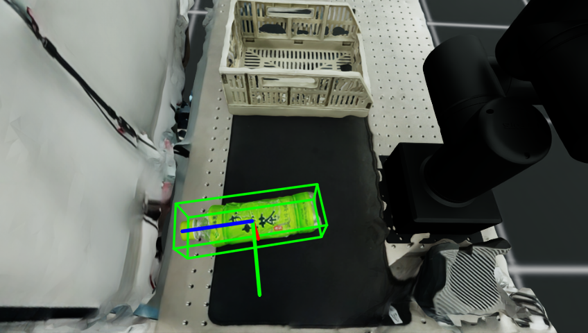

# Effector-Aware FoundationPose

Research workspace for adding robot end-effector context to
[FoundationPose](https://github.com/NVlabs/FoundationPose). The unchanged
pretrained pipeline is preserved as the control for evaluating method changes.

## Current state

The unchanged, pretrained model-based FoundationPose demo has passed on the
project machine's RTX 3070. It produced poses for all 737 frames of the mustard
bottle sequence. See [`docs/BASELINE.md`](docs/BASELINE.md) for the reproducible
run record and [`SETUP_STATUS.md`](SETUP_STATUS.md) for the current project
checkpoint.

The upstream FoundationPose source is pinned as a Git submodule under
`third_party/FoundationPose`; downloaded assets and generated results are kept
outside Git.

## Isaac Sim result

This is a project-generated OMY/green-tea-bottle frame rendered in Isaac Sim,
then processed by the unchanged pretrained FoundationPose estimator. It is not
an image from the upstream FoundationPose demo. The green box and colored axes
show the estimated 6-DoF bottle pose.



[Watch the short side-by-side Isaac RGB and FoundationPose overlay](docs/assets/isaac_omy_foundationpose_control.mp4).

The **192-frame corrected-calibration control** includes six completely hidden
bottle frames. Mean translation error rises from 0.94 mm with at least half
the reference visible area to 36.10 mm below that level, peaking at 101.66 mm.
The unchanged estimator completed all frames; effector-aware candidate pruning
is the next experiment, not yet implemented.

**September 22 checkpoint:** robot-link geometry export and a GPU projection
audit now pass on all 192 frames and 11 links (minimum visible robot IoU
98.36%). The audit exposed a stale camera-pose cache after reset randomization;
new captures refresh the camera pose on every frame. This is a calibration
correction, not an effector-aware accuracy improvement. See
[`docs/ROBOT_GEOMETRY.md`](docs/ROBOT_GEOMETRY.md) for results and reproduction.
The [earlier dynamic control](docs/ISAAC_DYNAMIC_CONTROL.md) is retained with
its calibration caveat.

## Repository layout

- `configs/`: experiment and runtime configuration
- `data/isaac_exports/`: local simulator exports (not committed)
- `docs/`: design notes and handoffs
- `experiments/`: experiment definitions and summaries
- `outputs/`: generated results (not committed)
- `scripts/`: setup, conversion, and evaluation entry points
- `src/foundationpose_adapter/`: integration with upstream FoundationPose
- `src/calibration/`: camera and robot-frame calibration
- `src/masks/`: segmentation-mask preparation
- `src/urdf_render/`: URDF-based geometry rendering
- `src/candidate_pruning/`: end-effector-aware pose candidate filtering
- `src/evaluation/`: metrics and evaluation support

Isaac Sim captures must follow the versioned
[`docs/ISAAC_EXPORT_CONTRACT.md`](docs/ISAAC_EXPORT_CONTRACT.md). Validate a
capture before inference with:

```bash
python3 scripts/validate_isaac_export.py data/isaac_exports/<sequence>
```

The OMY bottle capture and contract-to-FoundationPose entry points are now in
place. Their verification state and the resolved renderer compatibility issue
are recorded in
[`docs/ISAAC_INTEGRATION.md`](docs/ISAAC_INTEGRATION.md).

Evaluate a simulated run against its embedded ground truth with:

```bash
python3 scripts/evaluate_pose_results.py outputs/<run>/poses.jsonl
```

For a single consolidated record of completed work, Git checkpoints, blockers,
and prioritized next steps, see
[`docs/PROJECT_SUMMARY.md`](docs/PROJECT_SUMMARY.md).

The renderer crash diagnosis and recovery gates are documented in
[`docs/ISAAC_CRASH_RECOVERY.md`](docs/ISAAC_CRASH_RECOVERY.md).

After the host driver is restored to the 580 branch, the preferred isolated
OMY capture entry point is `scripts/run_omy_isaac_capture_docker.sh`.

The first passing ten-frame Isaac/OMY control and its pose errors are recorded
in [`docs/ISAAC_CONTROL.md`](docs/ISAAC_CONTROL.md).

For the exact reboot boundary and continuation commands, see
[`docs/RESUME_AFTER_REBOOT.md`](docs/RESUME_AFTER_REBOOT.md).

## Clone

```bash
git clone --recurse-submodules <repository-url>
cd effector-aware-foundationpose
```

For an existing clone, initialize the pinned dependency with:

```bash
git submodule update --init --recursive
```

After installing the upstream image, weights, demo data, and native extension
described in the baseline record, reproduce the unchanged demo with:

```bash
./scripts/run_foundationpose_baseline.sh
```

## Licensing and data

FoundationPose is governed by its own NVIDIA license in the submodule. In
particular, review its research/evaluation and redistribution restrictions
before use. Pretrained weights, demo data, simulator exports, and generated
outputs must remain outside Git.
