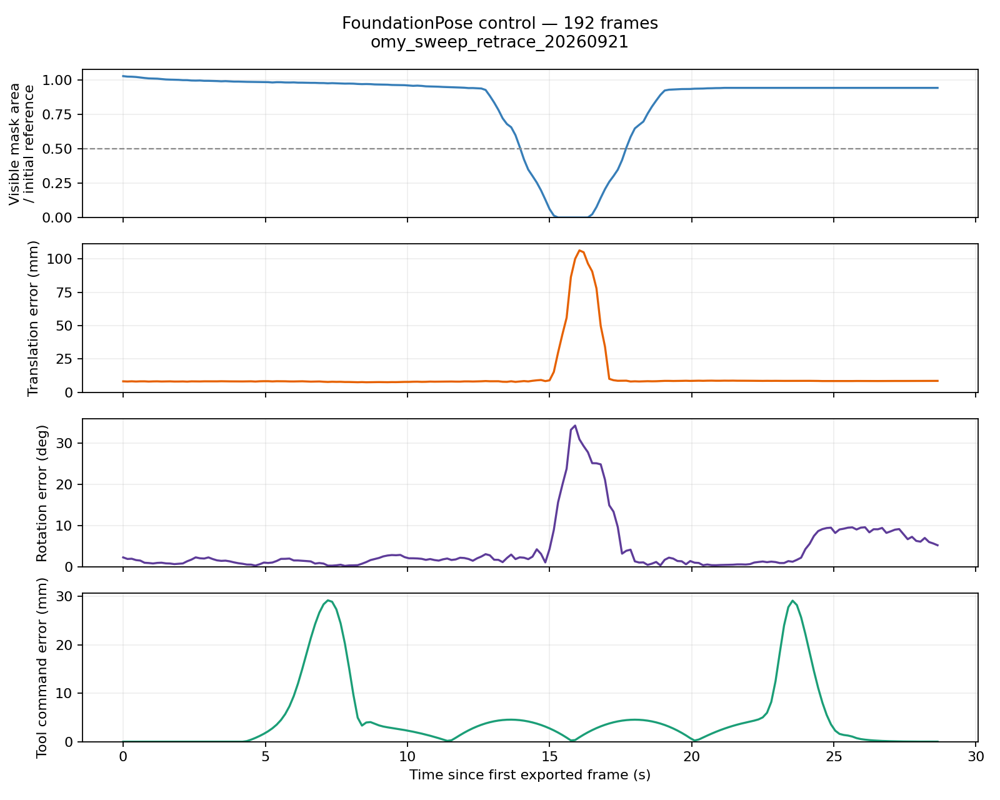

# Isaac/OMY dynamic control

Updated: 2026-09-21 (Asia/Seoul)

## Accepted control

The 192-frame `omy_sweep_retrace_20260921` capture passed the export validator
and the 30 mm tool-command-error gate. The unchanged pretrained FoundationPose
estimator completed every frame. This validates the experiment pipeline, not
robust tracking under full occlusion: the estimator drifts substantially while
the bottle is hidden and recovers as it reappears.



| Camera-frame error | Mean translation | Mean rotation | Frames |
| --- | ---: | ---: | ---: |
| Entire sequence | 12.347 mm | 4.343 degrees | 192 |
| Visible area at least half the initial reference | 8.227 mm | 2.700 degrees | 168 |
| Visible area below half the initial reference | 41.183 mm | 15.846 degrees | 24 |

Maximum translation error is 106.435 mm at frame `000107`; maximum rotation
error is 34.207 degrees at `000106`. Frames `000103` through `000108` have
empty visible-object masks. By frame `000118`, error is back to 8.690 mm and
3.924 degrees. The final frame has 8.535 mm and 5.259 degrees error. Camera- and
effector-frame error magnitudes agree, as expected under rigid frame changes.
Overlays at full occlusion, reappearance and the final frame were inspected.

Capture details:

- One OMY gripper and one 848 x 480 top camera; seed 42.
- Timestamps 0.75–29.40 s, 0.15 s between samples, 28.65 s first-to-last.
- End-effector command error: 4.629 mm mean, 29.165 mm maximum.
- Largest sampled tool displacement: 11.563 mm between adjacent frames.
- The bottle moves 42.874 mm and rotates 81.054 degrees from its initial pose
  under simulator physics; it is not attached to the gripper.
- RTX 3070, driver 580.178.04; existing ROBOTIS and FoundationPose images.
- Cold registration: 3.026 s for 252 candidates. Tracking: 23.984 ms mean,
  23.607 ms median across 191 calls. These are estimator-call measurements,
  not end-to-end throughput.

The raw export is under `data/isaac_exports/omy_sweep_retrace_20260921` and
results under `outputs/omy_sweep_retrace_20260921_control`, both ignored by Git.
The original ten-frame static control is retained unchanged.

```bash
./scripts/run_omy_isaac_capture_docker.sh \
  --output /workspace/ea-foundationpose/data/isaac_exports/omy_sweep_retrace_20260921 \
  --motion effector-sweep --frames 192 --stride 3
python3 scripts/validate_isaac_export.py data/isaac_exports/omy_sweep_retrace_20260921
./scripts/run_isaac_foundationpose.sh data/isaac_exports/omy_sweep_retrace_20260921 \
  --output /workspace/outputs/omy_sweep_retrace_20260921_control --save-vis
python3 scripts/evaluate_pose_results.py outputs/omy_sweep_retrace_20260921_control/poses.jsonl \
  --json-out outputs/omy_sweep_retrace_20260921_control/metrics.json
python3 scripts/analyze_isaac_sequence.py data/isaac_exports/omy_sweep_retrace_20260921 \
  --poses outputs/omy_sweep_retrace_20260921_control/poses.jsonl \
  --json-out outputs/omy_sweep_retrace_20260921_control/sequence_metrics.json
```

Use new output names for new runs to preserve this control. All 19 offline
tests, Python compilation, export validation and Git whitespace checks passed.

Artifact SHA-256 hashes:

```text
1d00686f737fc52dd1861604a049f520a55bf3a7fb40052525a4b34d559b4356  manifest.json
b273ad8f78dbb0b05e49ce9306667b3655404594626de99a3c393ba2b15c448f  frames.jsonl
1e28a0eab8f797671e9a92ca927a24cc2ff30f473b5169d37297608577238f4e  mesh/object.obj
cc90e929b8813e6153b1205e61e320960e28fc9e3e02a192d58f5fcabb2bdfcf  poses.jsonl
```

## Capture corrections

The original sweep draft did not produce the commanded smooth trajectory.
Before accepting a dynamic control, the capture adapter was corrected in the
following ways:

- Only the requested camera and its observation term are created. The unused
  task recorder is disabled so it does not retain RGB observations on the GPU.
- Rendering occurs at the final physics substep of each environment step.
  The previous decimation=5/render_interval=2 combination could export an
  image from a different instant than the poses.
- The episode duration covers the requested capture. Any unexpected task
  termination aborts the capture; the contract validator also rejects repeated
  or decreasing timestamps.
- The installed Isaac Lab action combines a PhysX center-of-mass Jacobian
  with link-origin positions. `src/calibration/isaac_ik.py` shifts the linear
  Jacobian to the link origin, expressing all quantities in the robot base
  frame. The PhysX buffer is cloned before modification.
- Tool targets are converted to link6-origin targets using the rotated
  `[0, -0.248, 0]` tool offset. This avoids the installed action's separate
  body-local/base-frame offset mismatch.
- The sweep pitches the fingers downward during approach and restores the
  home orientation on return. The original constant horizontal orientation
  failed the measured tracking check on both low and raised trajectories.
  The tool travels home → sweep start → sweep end → sweep start → home;
  returning along the approach path avoids the large tracking error of the
  direct sweep-end-to-home shortcut.
- Sweep-only simulated arm drives use stiffness 1000, damping 100, and a
  1.5 rad/s velocity limit. Static mode retains the task's original drives.
- A sweep exceeding `--max-effector-error-m` (default 0.03 m) retains diagnostic
  frames but does not publish a valid manifest. Errors are printed before Kit
  shutdown, which otherwise can terminate with status zero while an exception
  is pending.

These changes are confined to this repository. Neither the ROBOTIS Lab
checkout nor the pinned FoundationPose submodule was edited.

## IK verification

The diagnostic perturbs each arm joint by 0.001 rad, measures actual link
motion, and compares it with the predicted Jacobian displacement. The maximum
translation discrepancy divided by the nominal perturbation fell from
0.10324 m/rad to 0.000133 m/rad across all six joints. This verifies the local
Jacobian conversion; it does not by itself establish trajectory reachability.

```bash
./scripts/run_omy_isaac_capture_docker.sh \
  --output /workspace/ea-foundationpose/data/isaac_exports/omy_ik_check \
  --motion effector-sweep --diagnose-ik
```

The diagnostic writes `ik_diagnostics.json` and fails when the maximum
translational discrepancy exceeds 0.001 m/rad.

## Measurements

`analyze_isaac_sequence.py` audits camera, object and end-effector motion,
tool command error, visible mask area, and matched pose results. Pose rows
must have matching frame IDs and timestamps. New inference runs additionally
record hashes of the input manifest and frame metadata; the analyzer checks
them before comparing results.

Visibility is measured relative to the median mask area during the initial
stationary phase. It is a visible-area diagnostic, not an exact occlusion
fraction: the bottle can roll and change its projected area.

The inference runner records CUDA-synchronized estimator time, excluding
image decoding, visualization and output writing. Cold registration includes
kernel initialization. Tracking and registration timings are reported
separately. `plot_isaac_control.py` plots visibility, pose errors and tool
command error using matplotlib in the FoundationPose image.

## EA experiment boundary

End-effector-aware candidate pruning is not implemented yet. The unchanged
estimator registers with 252 candidates on the first frame, then tracks with
one pose. A pruning comparison must therefore measure registration or
explicit recovery attempts, rather than claiming a tracking speedup from
this register-once control.

The gripper is an occluder in this sequence; the bottle is not rigidly grasped.
A fixed object-to-effector prior would be invalid here. An eventual pruning
rule needs actual robot-geometry constraints, or a separately validated
grasped-object sequence. Simulator object truth remains evaluation-only.

Earlier local captures named `omy_sweep_20260921`,
`omy_sweep_corrected_20260921`, `omy_sweep_damped_20260921`,
`omy_sweep_validated_20260921`, `omy_sweep_high_20260921`,
`omy_sweep_downward_20260921`, and `omy_sweep_slow_20260921` are diagnostic
attempts, not accepted smooth-motion controls. The initial attempt completed
FoundationPose inference (7.963 mm / 1.593 degrees mean error), but its robot
motion was erratic; that result must not be substituted for a validated sweep.
