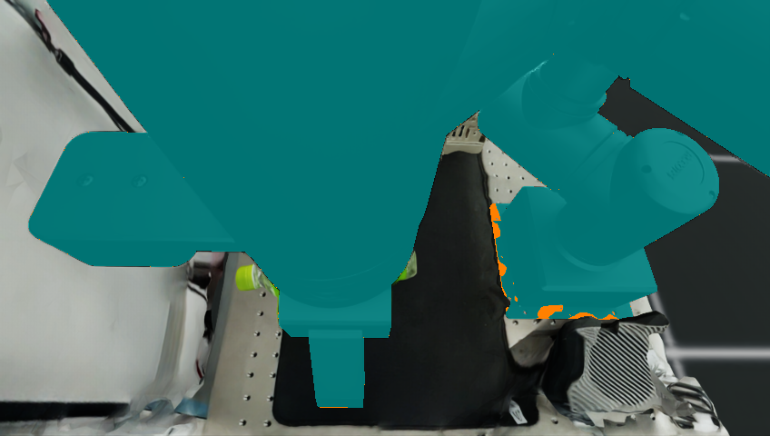

# Robot-geometry checkpoint

Updated: 2026-09-22 (Asia/Seoul)

## Scope

This document records the geometry checkpoint at `e153272`. The subsequent
filtering implementation is described in [CANDIDATE_FILTERING.md](CANDIDATE_FILTERING.md).

This milestone exports OMY's rigid-link visual meshes and synchronized link
poses, and checks their projection against Isaac's camera data. It prepares
the geometry input for effector-aware candidate screening. **It does not yet
change FoundationPose's object-pose estimates or implement candidate pruning.**

`RobotDepthRenderer` uses only link meshes, robot poses, camera pose, and camera
intrinsics. Its output is an amodal robot depth image (zero off the robot),
including arm, wrist, palm and fingers. It does not read the bottle ground
truth, object masks, RGB, or simulator robot semantic masks. Link poses are
ideal simulator proprioception, not an encoder-noise/FK experiment.

The optional contract extension, mesh hashes and per-frame transforms are
described in [ISAAC_EXPORT_CONTRACT.md](ISAAC_EXPORT_CONTRACT.md).

## Camera calibration correction

Isaac Lab's `CameraCfg.update_latest_camera_pose` defaults to False. The OMY
task randomizes the camera during reset, after the camera cache is populated.
The previous export therefore recorded a stale camera pose. Camera-relative
ground truth and robot projection were biased even though RGB-D was valid.
The exporter now enables live pose updates for both top and wrist cameras.

The first geometry projection audit detected this: minimum visible robot IoU
was 0.3103 and worst per-frame 95th-percentile depth disagreement was 65.7 mm.
The failed `omy_robot_geometry_v1_20260922` capture is retained as a diagnostic,
not accepted geometry-aware input. The older static/dynamic controls remain
unchanged and explicitly carry this calibration caveat.

## Verified geometry result

The corrected `omy_robot_geometry_calibrated_20260922` export contains 192
frames and 11 rigid-link meshes. All frames pass the unchanged projection
gates. The tool trajectory also passes the 30 mm capture gate (29.165 mm max).
The bottle is fully hidden in six frames and below half its reference visible
area in 24 frames.

| Projection measurement | Result |
| --- | ---: |
| Minimum visible robot IoU across frames | 0.98357 |
| Minimum coverage of semantic robot pixels | 0.99975 |
| Worst per-frame 95th-percentile depth error | 0.477 mm |
| Median GPU render time, excluding first frame | 2.77 ms |

The refreshed camera pose differs from the stale one by 10.259 mm and 0.658
degrees. Meshes and robot motion were not adjusted to fit the audit images.
The cached-pose negative control failed the same gates (above); enabling live
camera poses fixed the mismatch.



Artifact SHA-256 hashes:

```text
716b73d1c2f4c4e9b66ce04223dea57bead3247b56daa77881553a94df851efb  manifest.json
c05a0d8bc88af17a358b8aac07e8a232bc1a1cbcce44be3b6fcee2e51e09d7bf  frames.jsonl
fc5bd92c14446a957230e763ee5897bff91bd22ddd2211b811d8f81a9a8f9aa1  mesh/object.obj
4d3f9c56ba900b88ef25408a6faa51e77aafc998036c7c4cd033ecb8d8307431  control/poses.jsonl
```

Individual mesh hashes are in the manifest. The complete 192-frame audit and
selected overlays are local under
`outputs/omy_robot_geometry_calibrated_20260922_audit`.
All 34 offline tests pass, including malformed geometry and audit-gate cases.

## Corrected unchanged-estimator baseline

The unchanged pretrained estimator completed all 192 corrected-calibration
frames in `outputs/omy_robot_geometry_calibrated_20260922_control`.

| Camera-frame error | Mean translation | Mean rotation | Frames |
| --- | ---: | ---: | ---: |
| Entire sequence | 5.332 mm | 4.671 degrees | 192 |
| Visible area at least half the initial reference | 0.937 mm | 3.090 degrees | 168 |
| Visible area below half the initial reference | 36.098 mm | 15.735 degrees | 24 |

Peak translation error is 101.665 mm; peak rotation error is 35.576 degrees.
Cold registration takes 3.012 s for 252 candidates; 191 tracking calls average
23.282 ms (estimator-call timing, not end-to-end throughput).
This is **not an effector-aware improvement**: the estimator is unchanged and
the camera-relative evaluation reference was corrected. It is one seeded
simulation sequence, not a generalization result or a held-out experiment.

## Reproduction

Prerequisites are the existing ROBOTIS Lab assets/image and FoundationPose GPU
image described in [ISAAC_INTEGRATION.md](ISAAC_INTEGRATION.md). Raw assets,
captures and outputs are ignored by Git; a fresh clone must regenerate them.
Use new output names if these paths already exist.

```bash
./scripts/run_omy_isaac_capture_docker.sh \
  --output /workspace/ea-foundationpose/data/isaac_exports/omy_robot_geometry_calibrated_20260922 \
  --motion effector-sweep --frames 192 --stride 3 --export-robot-geometry
python3 scripts/validate_isaac_export.py \
  data/isaac_exports/omy_robot_geometry_calibrated_20260922
./scripts/run_isaac_foundationpose.sh \
  data/isaac_exports/omy_robot_geometry_calibrated_20260922 \
  --audit-robot-geometry \
  --output /workspace/outputs/omy_robot_geometry_calibrated_20260922_audit
./scripts/run_isaac_foundationpose.sh \
  data/isaac_exports/omy_robot_geometry_calibrated_20260922 \
  --output /workspace/outputs/omy_robot_geometry_calibrated_20260922_control --save-vis
python3 scripts/evaluate_pose_results.py \
  outputs/omy_robot_geometry_calibrated_20260922_control/poses.jsonl \
  --json-out outputs/omy_robot_geometry_calibrated_20260922_control/metrics.json
python3 scripts/analyze_isaac_sequence.py \
  data/isaac_exports/omy_robot_geometry_calibrated_20260922 \
  --poses outputs/omy_robot_geometry_calibrated_20260922_control/poses.jsonl \
  --json-out outputs/omy_robot_geometry_calibrated_20260922_control/sequence_metrics.json
```

The audit does not load FoundationPose weights. It rasterizes robot geometry,
then uses measured scene depth to remove robot surfaces hidden by other scene
objects. Audit-only Isaac robot semantic masks provide the comparison target.
For each frame, acceptance requires visible IoU >= 0.95, robot pixel coverage
>= 0.98, and 95th-percentile depth error <= 10 mm. Gates were fixed before the
first audit and were not relaxed after failure. These are engineering checks,
not a claim of exact pixel agreement or improved object tracking.

Reports and selected overlays are saved even when an audit fails; failure
returns a nonzero status. Cyan marks reconstructed visible robot pixels and
orange marks semantic disagreement. Timing excludes mesh loading, readback,
and audit calculations; do not call it end-to-end inference latency.

## Next implementation step

1. Preserve the corrected-calibration baseline above on the same capture.
2. Add a candidate-screening adapter outside the upstream submodule. Use
   robot depth to avoid penalizing candidate bottle surfaces hidden behind
   the robot, while comparing the predicted visible bottle with observations.
3. Compare original 252-candidate registration, matched-count random selection,
   geometry-only selection, and robot-aware selection on identical frames.
   Include rendering/screening overhead in runtime and test calibration noise.
4. Use separate sequences for tuning and held-out evaluation. Object truth is
   evaluation-only. Simulator object masks, if used for registration, must be
   disclosed and supplied identically to all methods.

The bottle is free, not grasped. Do not introduce a fixed bottle-to-gripper
transform or claim that hidden free-object motion can be observed. Normal
FoundationPose tracking uses one pose; candidate pruning must first be tested
on registration or explicit recovery searches, not claimed as a tracking speedup.
