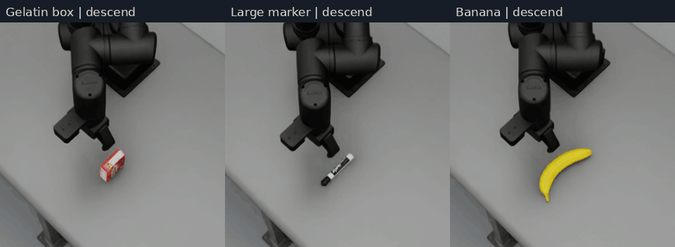
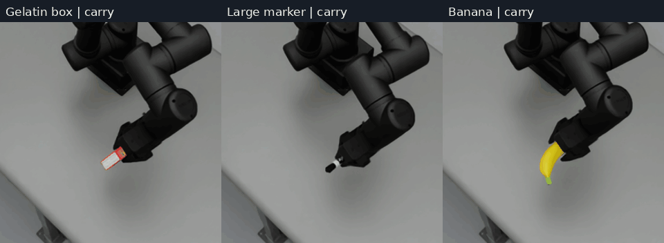
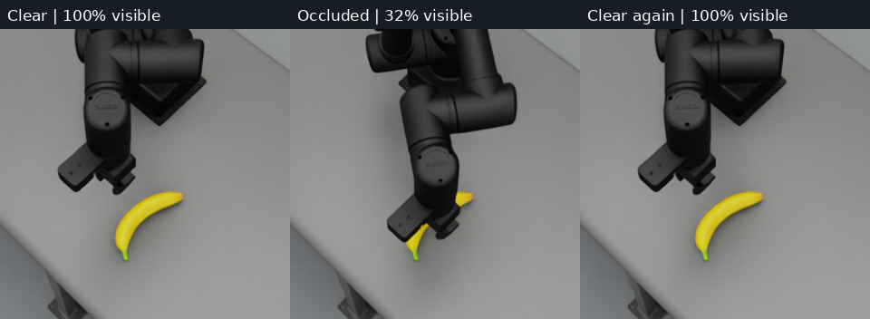

# OMY pilot pipeline handover

## Delivered result

The pilot contains **45 accepted sequences / 11,999 frames**, with 36 training
and 9 validation sequences. Each of three native-scale NVIDIA YCB objects
(gelatin box, large marker, banana) has five examples of each task:

- A: clear view → noncontact robot occlusion → clear view.
- B: physical grasp → lift → hold → translation and rotation.
- C: place → physical release → retreat, starting with a held-object preroll.

The scene uses the NVIDIA packing table, OMY robot, and simple floor/wall.
The final audit checks all 45 entries and decodes all 90 RGB/overlay MP4s.
FoundationPose initialization, partner loading confirmation, and tracking
accuracy are **not** established by these capture checks. C permits a partially
visible initialization preroll; evaluate that initialization protocol explicitly.

## Visual results

These are crops of actual accepted RGB frames, sampled at 10 fps, not generated
illustrations. Panel titles show recorded phases. Shorter release clips hold
their final frame. Sources and crop coordinates are in [visual_sources.json](media/visual_sources.json).

Physical grasp, lift and carry:



Corrected placement, release and retreat:



Noncontact occlusion; percentages are visible/amodal object area:



## What is in Git and what is local

Git contains code, configs, this handover, [results](PILOT_RESULTS.md),
[living plan](PLAN_AND_PROGRESS.md), the visuals above, and compact
[evidence](evidence/). The [dataset manifest](evidence/dataset_manifest.json)
identifies every accepted sequence. The [cohort audit](evidence/cohort_audit_final_001.json)
and [checksums](evidence/accepted_checksums.sha256) support verification.

The full RGB-D payload is intentionally excluded by the repository's existing
`outputs/**` ignore rule: **7.543 GB logical / 3.597 GB with hardlink deduplication**.
It is not downloaded by cloning this repository. On the capture workstation:

```text
/home/a09/mj-projects/omy-tracking-dataset/outputs/omy_pilot/dataset/
/home/a09/mj-projects/omy-tracking-dataset/outputs/omy_pilot/index.json
/home/a09/mj-projects/omy-tracking-dataset/outputs/omy_pilot/pilot_demo.mp4
```

Use `dataset/` as the delivered data, not older `accepted/`, handoff, or diagnostic
folders. Ten original C clips were withdrawn and replaced; their files remain
preserved outside the clean dataset. The authoritative index retains that history.

To transfer the data, copy the clean `dataset/` directory using a method that
preserves hardlinks (for example `rsync -aH`). Place `accepted_checksums.sha256`
next to that directory and verify from its parent:

```bash
sha256sum -c accepted_checksums.sha256 --quiet
```

No external data-hosting destination has been configured. Do not describe the
full RGB-D payload as present on GitHub.

## Read data / connect the tracking pipeline

The delivered folder includes `reader/` with a minimal requirements file and
standalone reader, robot-surface, and FK modules. Loading does not require Isaac Sim.
Alternatively, use the matching modules under repository `scripts/`.

```python
import sys
sys.path.insert(0, "outputs/omy_pilot/dataset/reader")
from read_omy_tracking_sample import read_tracking_input
from omy_robot_surface import canonical_surface_points, robot_surface_pair

# Initialize pose externally on frame 0 using CAD and your declared mask protocol.
# Supply that ESTIMATED pose, not a ground-truth pose from frames.jsonl.
sample = read_tracking_input(
    "outputs/omy_pilot/dataset/box_B_00", 1,
    previous_estimated_pose=estimated_T_camera_object_0,
)
canonical = canonical_surface_points(sample["robot_geometry"], 1024, seed=0)
features = robot_surface_pair(sample, canonical)
# Reuse canonical on following frames. Feed each new estimated pose back as
# previous_estimated_pose for the next input.
```

Read [HANDOFF.md](HANDOFF.md) and [EXPORT_EXTENSION.md](EXPORT_EXTENSION.md) for
coordinate details. Depth is optical-axis uint16 millimetres, zero invalid;
the reader converts to metres. Joints use radians, timestamps simulated seconds.
`T_A_B` maps B into A using column vectors; camera axes are OpenCV.
The preceding measured robot state is available even for clip frame 0.

**Inference boundary:** use RGB-D, previous estimated object pose, measured robot
states, calibration and geometry. Do not read GT object pose, contact, phase or
success labels into the tracker. `oracle_mask=True` is a separate explicitly
labelled oracle-segmentation comparison. Current reader tests block privileged
file access; they do not demonstrate tracking accuracy.

Preserve the existing 36/9 split. Clips from one physical parent cannot cross
splits. Replacement C clips have distinct parent episodes, but retain their
variant's split. Do not assume B and C always come from one continuous capture.

## Capture environment and assets

Validated workstation: RTX 5080 / 16 GB; Isaac Sim 6.2, Python 3.12. The working
simulator interpreter is configured in `configs/omy_tracking/pilot_capture.json`:

```text
/home/a09/robotics/isaaclab-so101/examples/isaaclab/.venv/bin/python
```

Use the native PhysX tensor path. The Isaac Lab articulation reset encountered
an unresolved Warp ProxyArray issue; importing Lab successfully is not a dynamics
test. No driver replacement is needed for this working capture path.

Asset URLs/pins are in `configs/omy_tracking/assets.json`. Native OMY comes from
cyclo_lab revision `a44392325d2ccb250ba77ece3237b55ba1f206e1` at the local path
recorded there. The three targets are `009_gelatin_box.usd`,
`040_large_marker.usd`, and `011_banana.usd`. The static scene is
`outputs/omy_workstation_preview_007/workstation.usda`.

Simulator scenes, downloaded assets, robot/object model exports, and physics
inventory are local prerequisites, not bundled Git assets. Inspect the configured
paths before capture. The existing capture configuration references:

- `outputs/omy_target_model_001`, `omy_marker_model_001`, `omy_banana_model_001`;
- `outputs/omy_robot_geometry_001` and `omy_physics_inventory_001`;
- model-equivalence audits and the sample handoff under `outputs/`.

The preview, asset/model export, inventory, and render-audit scripts are included
for rebuilding these prerequisites. Review their CLI help and verify the pinned
source USD before accepting a rebuilt scene. Observe upstream asset license terms;
GitHub publication of this pipeline is not an asset redistribution clearance.

## Pipeline entry points

| Stage | Script | Result |
|---|---|---|
| Capture | `render_omy_motion_check.py` | Native joint-driven physics; original RGB-D/masks; measured states and privileged diagnostics |
| Resource measurement | `run_omy_capture_measured.py` | Capture wall time, bytes, sampled whole-GPU memory, artifact checks |
| Physical behavior | `check_omy_task_behavior.py` | Noncontact stationarity, bilateral grasp/hold, carry, support and release |
| Joint limits | `check_omy_joint_limits.py` | Finite states and authored limits, 0.001-rad numerical allowance |
| FK | `audit_omy_all_link_fk.py` | Independent measured-link versus encoder FK comparison |
| Geometry/visibility | `audit_omy_exported_geometry.py` | Every-frame mesh replay, RGB-D alignment, amodal visibility, overlay MP4 |
| Package | `package_omy_sample.py` | Clip-local data, geometry, previous state, calibration and provenance |
| Acceptance | `validate_omy_sample.py` | All required technical checks; unknown/missing checks fail |
| Pilot orchestration | `run_omy_pilot.py` | Fresh attempts, retained failures, resumable 45-slot index |
| Release repair | `repair_omy_release_sequences.py` | Historical targeted replacement of the withdrawn C clips |
| Clean export | `finalize_omy_pilot_dataset.py` | Portable selected dataset; refuses to overwrite an existing export |
| Final audit | `audit_omy_pilot_cohort.py` | Whole-cohort evidence, splits, joint states, hashes, 90 MP4 decodes |
| Reporting | `summarize_omy_pilot.py`, `update_omy_pilot_progress.py` | Checksums, results and living progress |

Raw capture alone does not establish acceptance. The immutable technical report
may predate selection; `validation/pilot_acceptance.json` and the final index
record selection, and the independent postflight audit applies to every final clip.

On the existing workstation the completed runner is resumable:

```bash
python3 scripts/run_omy_pilot.py \
  --review-record configs/omy_tracking/review_decision_20261113.json
```

It should skip all 45 accepted slots. Do not run finalization over an existing
`dataset/` folder. For a new cohort, copy the capture config, choose a fresh
`output_root`, rebuild/verify prerequisites, and use fresh audit/report paths.
The recorded review decision covers this pilot; it is not authorization for a
720-sequence dataset or unrelated future work. EULA acceptance was supplied by
the user on this machine; scripts must respect the destination machine's setup.

## Critical release fix — preserve it

Opening while continuously following the moving fingertip center lowered the
wrist into the table. Ten low-grasp C clips exceeded a passive finger's authored
limit. A gradual opening alone did not fix this. The validated controller:

1. Freezes the grasp control offset during opening and retreat.
2. Opens over 30 frames toward a 0.02-rad open-angle margin.
3. Raises the gripper 40 mm over 15 frames only after two frames of no robot/target
   contact while table support remains.
4. Rejects any nonfinite state or joint-limit violation beyond 0.001 rad.

Do not remove this state check or restore the old moving-fingertip release rule.
Run capture and geometry replay sequentially: frame-alignment failures appeared
during one overlap experiment, though causality was not proven. All failed and
withdrawn data were preserved; none is in the final clean dataset.

## Next implementation checks

- [ ] Partner transfers and verifies the clean dataset, then constructs inputs.
- [ ] Run real FoundationPose initialization, especially partially visible C starts.
- [ ] Connect the estimated-pose feedback loop and fixed canonical robot samples.
- [ ] Compare all methods with identical initialization/mask/split protocols.
- [ ] Measure tracking performance separately from capture/geometry validity.
- [ ] Agree on expansion scope and budget before generating beyond the pilot.
